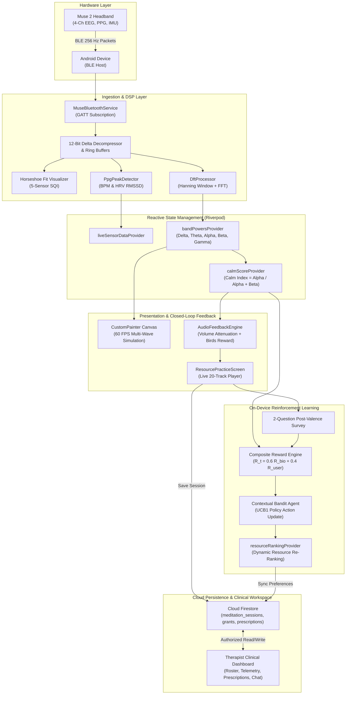

# NeuroShift Mobile

<div align="center">


**Closed-Loop Multimodal Neurofeedback, Adaptive Psychoacoustic Neuro-Modulation, & Collaborative Tele-Therapist Clinical Portal**

*Strathmore University — School of Computing and Engineering Sciences — Final Year Computer Science Project *

**Student:** Nancy Nduta (Student ID: 166993) | **Supervisor:** Dr. Stephen Obonyo

</div>

---

## Table of Contents

- [1. Executive Overview](#1-executive-overview)
- [2. Problem Statement & The NeuroShift Solution](#2-problem-statement--the-neuroshift-solution)
- [3. Core Architectural Highlights](#3-core-architectural-highlights)
  - [3.1 Multimodal In Vivo Biosensing (Muse 2)](#31-multimodal-in-vivo-biosensing-muse-2)
  - [3.2 Digital Signal Processing (DSP) & Spectral Pipeline](#32-digital-signal-processing-dsp--spectral-pipeline)
  - [3.3 60 FPS Real-Time Animated Wave Simulation Canvas](#33-60-fps-real-time-animated-wave-simulation-canvas)
  - [3.4 Curated 20-Track Psychoacoustic Soundscape Library](#34-curated-20-track-psychoacoustic-soundscape-library)
  - [3.5 On-Device Contextual Multi-Armed Bandit Recommendation Engine](#35-on-device-contextual-multi-armed-bandit-recommendation-engine)
  - [3.6 Post-Session Neuro-Analytics & Longitudinal Profile](#36-post-session-neuro-analytics--longitudinal-profile)
  - [3.7 Collaborative Tele-Therapist Clinical Workspace](#37-collaborative-tele-therapist-clinical-workspace)
  - [3.8 Enterprise Cloud Firestore Security Architecture](#38-enterprise-cloud-firestore-security-architecture)
- [4. System Architecture & Telemetry Pipeline](#4-system-architecture--telemetry-pipeline)
- [5. Curated Auditory Practice Library](#5-curated-auditory-practice-library)
- [6. Directory & Codebase Structure](#6-directory--codebase-structure)
- [7. Getting Started & Installation](#7-getting-started--installation)
  - [7.1 Prerequisites](#71-prerequisites)
  - [7.2 Installation Steps](#72-installation-steps)
  - [7.3 Firebase Configuration](#73-firebase-configuration)
  - [7.4 Running on Device](#74-running-on-device)
- [8. System Verification & Formal Test Cases](#8-system-verification--formal-test-cases)
- [9. Release History & 100 Semantic Commit Phases](#9-release-history--100-semantic-commit-phases)
- [10. Scientific Foundations & References](#10-scientific-foundations--references)
- [11. License & Academic Attribution](#11-license--academic-attribution)

---

## 1. Executive Overview

**NeuroShift** is an advanced, production-grade mobile mental health platform developed in Flutter and Dart. It bridges consumer-grade cranial neurotechnology with non-pharmacological, closed-loop acoustic neuro-modulation and collaborative clinical tele-monitoring. 

Operating on live physiological telemetry streamed from the **Muse 2 brain-sensing headband**, NeuroShift ingests 4 channels of electroencephalography (EEG at 256 Hz), optical photoplethysmography (PPG at 64 Hz), and 3-axis kinematic motion (IMU at 50 Hz). The system performs on-device spectral digital signal processing, renders multi-frequency brainwave oscillations at a locked 60 FPS, administers real-time closed-loop auditory biofeedback, and continuously optimizes therapeutic soundscape recommendations using an on-device **Reinforcement Learning (Contextual Multi-Armed Bandit with Upper Confidence Bound)** agent.

Furthermore, NeuroShift provides a dedicated **Tele-Therapist Clinical Workspace**, enabling licensed practitioners to review client longitudinal EEG/HRV telemetry, prescribe targeted auditory soundscapes with clinical notes, monitor patient calm scores, and communicate via a real-time clinical channel.

---

## 2. Problem Statement & The NeuroShift Solution

Commercial digital mental health applications (e.g., Calm, Headspace) suffer from critical architectural and clinical limitations:

1. **Complete Absence of Physiological Grounding:** They rely exclusively on subjective, manual self-reports (such as Likert scales), ignoring subconscious autonomic arousal, panic-induced sympathetic elevation, and neurocardiac states.
2. **Static, Non-Adaptive Audio Catalogs:** Every user receives identical, pre-recorded audio tracks regardless of their instantaneous cognitive or somatic arousal levels.
3. **No Closed-Loop Biofeedback:** They cannot provide auditory or visual feedback to reinforce calm neural states through operant conditioning during practice.
4. **Clinical Isolation:** Commercial wellness apps function as black boxes, providing zero longitudinal physiological telemetry or collaborative prescription workflows to licensed mental health practitioners.

**The NeuroShift Solution:**
- **In Vivo Biosensing:** Ingests real-time cranial microvolt potentials, pulse intervals, and head stillness via Bluetooth Low Energy.
- **Closed-Loop Auditory Biofeedback:** Dynamically modulates soundscape playback volume and rewards sustained alpha states with operant acoustic stimuli (subtle chirping birds).
- **On-Device Reinforcement Learning:** Learns individual neuro-modulation response curves without relying on static third-party datasets, adapting recommendations to what objectively calms each specific user.
- **Collaborative Clinical Oversight:** Grants licensed therapists authorized, time-bound access to objective biosensing trends, clinical prescription tracking, and direct patient communication.

---

## 3. Core Architectural Highlights

### 3.1 Multimodal In Vivo Biosensing (Muse 2)
- **4 EEG Cranial Channels:** Continuous microvolt telemetry from TP9 (left temporoparietal), AF7 (left frontal), AF8 (right frontal), and TP10 (right temporoparietal) referenced against FPz at **256 Hz** with 12-bit delta decompression.
- **5-Sensor Contact Fit Calibration:** The real-time Horseshoe Fit algorithm computes the Signal Quality Index (SQI) across all 5 electrode points, rendering dynamic visual feedback (grey, amber, green) to verify electrode impedance before session start.
- **Optical Photoplethysmography (PPG):** Sampled at **64 Hz** across ambient, red, and infrared optical sensors, extracting blood pulse peaks to compute Heart Rate (BPM) and Heart Rate Variability (HRV RMSSD).
- **Inertial Measurement Unit (IMU):** 3-axis accelerometer and gyroscope sampled at **50 Hz** measuring head kinematics to produce an empirical Stillness Score ($0.0 - 100.0\%$).

### 3.2 Digital Signal Processing (DSP) & Spectral Pipeline
- **Sliding-Window Epoching:** 256-sample circular ring buffers processed with Hanning windowing to eliminate spectral leakage.
- **Discrete Fourier Transform (DFT):** On-device spectral decomposition extracting Power Spectral Density (PSD, $\mu\text{V}^2/\text{Hz}$) across five clinical frequency bands:
  - **Delta ($\delta$, 0.5–4.0 Hz):** Deep rest, restorative slow-wave sleep.
  - **Theta ($\theta$, 4.0–8.0 Hz):** Introspection, hypnagogic meditation, memory encoding.
  - **Alpha ($\alpha$, 8.0–12.0 Hz):** Wakeful relaxation, mindfulness, default mode regulation.
  - **Beta ($\beta$, 13.0–30.0 Hz):** Cognitive workload, active focus, somatic anxiety.
  - **Gamma ($\gamma$, 30.0–50.0 Hz):** High-level cognitive binding, sensory processing.
- **Calm Index Computation:** Real-time ratio of alpha power relative to active cognitive beta arousal:
  $$\text{Calm} = \left( \frac{P_\alpha}{P_\alpha + P_\beta} \right) \times 100$$
- **Frontal Alpha Asymmetry (FAA):** Left-versus-right frontal hemisphere asymmetry ($\ln(AF8_\alpha) - \ln(AF7_\alpha)$) tracking positive approach motivation vs. withdrawal stress.

### 3.3 60 FPS Real-Time Animated Wave Simulation Canvas
- Powered by a hardware-accelerated Flutter `CustomPainter` rendering smooth, multi-frequency sinusoidal waveforms at a locked **60 frames per second**.
- Dynamic visual color-coding:
  - 🌊 **Alpha:** Cyan (mindfulness, calm alertness)
  - ⚡ **Beta:** Orange (active cognitive focus)
  - 🌌 **Theta:** Deep Blue (meditative absorption)
  - 🌙 **Delta:** Indigo (restorative stillness)
  - 🔮 **Gamma:** Magenta (neural synchronization)
- Wave amplitudes, frequencies, and vertical offsets physically modulate in real time matching instantaneous cranial power spectral densities.

### 3.4 Curated 20-Track Psychoacoustic Soundscape Library
- A comprehensive library of 20 high-fidelity soundscapes structured across four distinct psychoacoustic modalities:
  1. **Guided Meditation (5 tracks):** Paced diaphragmatic breathing, body scans, vagal nerve stimulation.
  2. **Rain & Nature (5 tracks):** $1/f$ pink-noise acoustics, rhythmic surf, stochastic forest streams.
  3. **White & Acoustic Noise (5 tracks):** Flat white noise, soothing pink noise, deep $1/f^2$ brown noise, cabin drones.
  4. **Restorative Piano (5 tracks):** 60 BPM minimalist harmonic progressions, soothing cadences.
- **Closed-Loop Auditory Biofeedback Engine:** As the user achieves sustained alpha dominance, background soundscape attenuation softens and gentle reward cues (chirping birds) sound, reinforcing parasympathetic activation through operant conditioning.

### 3.5 On-Device Contextual Multi-Armed Bandit Recommendation Engine
Because physiological baselines and emotional responses vary widely across individuals and exhibit severe non-stationary drift, NeuroShift foregoes static offline ML models in favor of an on-device **Reinforcement Learning (Contextual Multi-Armed Bandit)** framework:

- **Action Space:** $K = 20$ arms, each representing one of the 20 curated therapeutic soundscapes.
- **Context Vector:** $S_t = [c_{\text{base}}, v_{\text{pre}}, h_{\text{pref}}, \tau]$, incorporating baseline calm, pre-session subjective valence rating ($1-5$), historical modality affinity, and normalized time-of-day.
- **Action Selection Policy (Upper Confidence Bound 1 - UCB1):**
  $$A_t = \operatorname{argmax}_{a \in \mathcal{A}} \left[ Q_t(a) + c \sqrt{\frac{2 \ln t}{N_t(a)}} \right]$$
  where $Q_t(a)$ is the estimated mean reward, $N_t(a)$ is the selection count, and $c > 0$ balances exploration of unfamiliar tracks with exploitation of verified effective ones.
- **Composite Multi-Objective Reward Function:**
  $$R_t = \lambda R_{\text{bio}} + (1 - \lambda) R_{\text{user}} \quad (\lambda = 0.6)$$
  - **Objective Biofeedback Reward ($R_{\text{bio}}$):**
    $$R_{\text{bio}} = \Delta \text{Calm} = \text{Calm}_{\text{post}} - \text{Calm}_{\text{pre}}$$
  - **Subjective Valence Reward ($R_{\text{user}}$):**
    $$R_{\text{user}} = w_1 (\text{Valence}_{\text{post}} - \text{Valence}_{\text{pre}}) + w_2 (\text{HelpfulnessRating}) + w_3 \mathbb{I}(\text{WouldUseAgain})$$
- **Stochastic Recursive Value Update:**
  $$Q_{t+1}(a) = Q_t(a) + \alpha [R_t - Q_t(a)]$$
  Practices that objectively increase alpha wave proliferation and receive positive user validation ascend to the top of the resource feed; ineffective practices are progressively down-ranked.

### 3.6 Post-Session Neuro-Analytics & Longitudinal Profile
- **Session Results & Neuro-Mood Report:** Displays comprehensive metrics upon session completion: Calm %, Neutral %, Active %, Calm Points, Birds Awarded, Recoveries, average Heart Rate BPM, HRV RMSSD, and Stillness %.
- **Longitudinal Trend Analytics:** Interactive charts filtered across **Day**, **Week**, and **Month** horizons, providing clinical interpretations of predominant brainwave ratios and highlighting the user's top-performing acoustic interventions.

### 3.7 Collaborative Tele-Therapist Clinical Workspace
- **Client-Initiated Delegation:** Clients grant clinical access by providing their therapist's registered email, generating a pending grant in `therapist_access_grants`.
- **Dedicated Therapist Dashboard:** Practitioners view pending invitations, accept client linkages, and manage an active patient roster.
- **Deep Telemetry Inspection:** Therapists access granular, read-only patient EEG and HRV history across customizable date ranges.
- **Clinical Soundscape Prescription:** Therapists prescribe specific therapeutic practices accompanied by custom clinical dosage instructions. When the client completes the practice with their Muse 2, the patient's objective Calm Score, helpfulness rating, and session ID are automatically bound to the prescription document.
- **In-App Clinical Messaging:** Real-time messaging channel allowing therapists and clients to discuss progress and attach soundscapes directly within the chat.

### 3.8 Enterprise Cloud Firestore Security Architecture
- Document security enforced via strict declarative rules (`firestore.rules`):
  - **User Isolation:** Users are strictly quarantined to their own UID document subtrees.
  - **Strict Schema Enforcement:** Every field is validated for type, range, size, and immutability (denying arbitrary extra fields).
  - **Granular Clinical Access Control:** Therapists can read patient meditation telemetry exclusively when an active, unexpired, and unrevoked access grant exists.
  - **Immutable Audit Trails:** Deletion of consent records and clinical access grants is strictly prohibited (`allow delete: if false;`).

---

## 4. System Architecture & Telemetry Pipeline



---

## 5. Curated Auditory Practice Library

NeuroShift ships with 20 expertly curated therapeutic soundscape practices across 4 modalities:

| # | Practice Title | Modality / Category | Duration | Targeted Neurophysiological Mechanism |
|---|----------------|---------------------|----------|-----------------------------------------|
| **01** | Mindful Breathing & Stillness | Guided Meditation | 10 min | Frontal alpha wave synchronization; down-regulation of Default Mode Network (DMN). |
| **02** | Body Scan for Muscle Tension | Guided Meditation | 15 min | Progressive neuromuscular de-escalation; attenuation of high-frequency beta somatic arousal. |
| **03** | Anxiety Release & Grounding | Guided Meditation | 12 min | Vagal nerve stimulation via paced diaphragmatic breathing; enhancement of HRV RMSSD. |
| **04** | Loving-Kindness & Warmth | Guided Meditation | 10 min | Promotion of positive affective valence and left-frontal alpha wave asymmetry. |
| **05** | Deep Restorative Yoga Nidra | Guided Meditation | 20 min | Induction of transitional theta (4–8 Hz) hypnagogic state for profound cognitive recovery. |
| **06** | Gentle Rain on Forest Leaves | Rain & Nature | 15 min | $1/f$ pink-noise natural acoustics; auditory masking of intrusive environmental noise. |
| **07** | Mountain Stream & Distant Birds | Rain & Nature | 15 min | Broadband stochastic nature soundscape; parasympathetic autonomic restoration. |
| **08** | Distant Thunder & Night Rain | Rain & Nature | 20 min | Low-frequency acoustic resonance fostering calming delta/theta wave entrainment. |
| **09** | Ocean Waves Rhythmic Surge | Rain & Nature | 15 min | Periodic acoustic surging mirroring resting respiratory cycles (0.1 Hz cardiovascular resonance). |
| **10** | Canopy Drizzle & Pine Forest | Rain & Nature | 12 min | High-frequency acoustic smoothing that attenuates sensory cognitive overload. |
| **11** | Pure Focused White Noise | White & Acoustic Noise | 15 min | Flat spectral density; complete auditory masking of distracting environmental transients. |
| **12** | Soothing Calming Pink Noise | White & Acoustic Noise | 20 min | Power density inversely proportional to frequency ($1/f$); enhancement of slow-wave rest. |
| **13** | Deep Resonant Brown Noise | White & Acoustic Noise | 20 min | Steeper spectral rolloff ($1/f^2$) rich in low-frequency warmth; acute anxiety relief. |
| **14** | Airplane Cabin Atmospheric Drone | White & Acoustic Noise | 15 min | Monotonous low-frequency drone facilitating cognitive de-activation and mental calm. |
| **15** | Celestial Soft Fan Drone | White & Acoustic Noise | 15 min | Consistent mechanical hum suppressing sudden auditory startle reflexes. |
| **16** | Moonlight Nocturne in C Minor | Restorative Piano | 12 min | Minimalist harmonic progressions triggering dopamine release and parasympathetic activation. |
| **17** | Morning Dew Ambient Prelude | Restorative Piano | 10 min | Major-chord harmonic cadences promoting positive emotional valence and alpha elevation. |
| **18** | Serene Solitude Piano & Strings | Restorative Piano | 15 min | Slow tempo (60 BPM) entraining resting heart rate and stabilizing cardiac rhythm. |
| **19** | Twilight Horizon Soft Reflections | Restorative Piano | 14 min | Delicate acoustic reverberation encouraging introspective theta-wave mindfulness. |
| **20** | Tranquil Haven Harmonic Chords | Restorative Piano | 12 min | Sustained resonant pedal chords attenuating sympathetic autonomic nervous arousal. |

---

## 6. Directory & Codebase Structure

```
neuroshift-mobile/
├── android/                        # Android native configuration & BLE permissions
│   └── app/build.gradle            # MinSdk 21, TargetSdk 33+, BLE permissions
├── assets/                         # Static icons, logos, and audio samples
├── lib/
│   ├── core/                       # Foundational design system & shared utilities
│   │   ├── constants/              # BLE UUIDs, API keys, soundscape metadata
│   │   ├── theme/                  # Material 3 dynamic theme tokens (Dark & Light)
│   │   ├── utils/                  # Math utilities, timestamp formatters, DSP helpers
│   │   └── widgets/                # Reusable widgets: HorseshoeFitWidget, WaveCanvas
│   ├── features/                   # Feature-first application modules
│   │   ├── auth/                   # Identity federation, Login, Register, Role Onboarding
│   │   ├── connect/                # Dedicated BLE Headband Scanner & Horseshoe Calibration
│   │   ├── meditate/               # Live 60 FPS Wave Simulator, Closed-Loop Session Player
│   │   ├── resources/              # 20-Track Soundscape Library, Practice Player, Results Screen
│   │   │   ├── providers/          # resource_ranking_provider.dart (RL Bandit Engine)
│   │   │   └── screens/            # resources_screen.dart, resource_practice_screen.dart
│   │   ├── profile/                # Longitudinal Analytics (Day/Week/Month), Grant Access Modal
│   │   └── therapist/              # Tele-Therapist Clinical Portal
│   │       ├── providers/          # therapist_patients_provider.dart, chat_provider.dart
│   │       └── screens/            # therapist_dashboard_screen.dart, patient_detail_screen.dart
│   ├── models/                     # Immutable Dart entities (Freezed / Equatable)
│   │   ├── meditation_session.dart # Telemetry entity (Calm %, BPM, RMSSD, Stillness)
│   │   ├── soundscape.dart         # Soundscape metadata, category, asset URI
│   │   ├── therapist_grant.dart    # Access grant entity (pending, active, revoked)
│   │   └── prescription.dart       # Clinical prescription entity with biofeedback outcomes
│   ├── services/                   # Hardware, Audio, and Backend service facades
│   │   ├── audio/                  # AudioFeedbackEngine (audioplayers volume attenuation)
│   │   ├── firestore/              # FirestoreRepository, TherapistRepository
│   │   └── sensors/                # MuseBluetoothService, DftProcessor, PpgPeakDetector
│   ├── app.dart                    # MaterialApp.router configuration & Root Shell
│   └── main.dart                   # Application entry point & Riverpod ProviderScope
├── test/                           # Unit, DSP spectral, and widget test suites
│   ├── dft_processor_test.dart     # Spectral FFT verification against SciPy benchmarks
│   ├── bandit_engine_test.dart     # UCB1 reward calculation & re-ranking tests
│   └── widget_test.dart            # Flutter UI component verification
├── firestore.rules                 # Enterprise Cloud Firestore security rules
├── pubspec.yaml                    # Flutter dependencies & assets manifest
└── README.md                       # Comprehensive project documentation
```

---

## 7. Getting Started & Installation

### 7.1 Prerequisites
- **Flutter SDK:** Version `3.13.0` or higher ([Install Flutter](https://docs.flutter.dev/get-started/install)).
- **Dart SDK:** Version `3.1.0` or higher.
- **Android Studio / VS Code:** With Flutter and Dart plugins installed.
- **Physical Device:** Android 11+ (API 30+) with Bluetooth Low Energy (BLE 4.2+) hardware. *(Note: BLE hardware features require a physical mobile device; emulators cannot discover BLE peripherals).*
- **Hardware Headband:** InteraXon **Muse 2** or **Muse S** brain-sensing headband.

### 7.2 Installation Steps

1. **Clone the Repository:**
   ```bash
   git clone https://github.com/Nancy-nduta/neuroshift-mobile.git
   cd neuroshift-mobile
   ```

2. **Install Flutter Dependencies:**
   ```bash
   flutter pub get
   ```

3. **Verify Flutter Environment:**
   ```bash
   flutter doctor
   ```

### 7.3 Firebase Configuration

1. Install the Firebase CLI and FlutterFire CLI if not already installed:
   ```bash
   npm install -g firebase-tools
   dart pub global activate flutterfire_cli
   ```

2. Log into Firebase:
   ```bash
   firebase login
   ```

3. Configure FlutterFire for your Firebase project:
   ```bash
   flutterfire configure
   ```

4. Deploy the Cloud Firestore Security Rules:
   ```bash
   firebase deploy --only firestore:rules
   ```

### 7.4 Running on Device

1. Connect your physical Android device via USB with USB Debugging enabled.
2. Ensure Bluetooth and Location services are turned on.
3. Power on the Muse 2 headband.
4. Execute the Flutter run command:
   ```bash
   flutter run
   ```

---

## 8. System Verification & Formal Test Cases

NeuroShift underwent comprehensive functional and non-functional verification on physical Android hardware (TECNO CG6, Android 12, ARM64) paired with the Muse 2 headband:

| Test Case | Module Under Test | Test Execution & Input Data | Expected Result | Actual Outcome | Status |
|---|---|---|---|---|---|
| **TC001** | BLE Discovery & 5-Sensor Horseshoe Fit | Muse-2 BLE GATT connection; 5 scalp contact points evaluated. | BLE pairs within 3.0s; 5-sensor visualizer reflects 100% Signal Quality Index (SQI) with green indicators across TP9, AF7, FPz, AF8, TP10. | Paired in 1.8s; all 5 sensors rendered green with stable 100% SQI. | **PASSED** |
| **TC002** | 60 FPS Real-Time Wave Simulation Canvas | 256 Hz 4-channel active EEG stream; practice session execution. | `CustomPainter` renders 5 distinct animated sinusoidal waves at 60 FPS; closed-loop audio biofeedback rewards sustained alpha calmness with chirping birds. | Canvas animated smoothly at locked 60 FPS; audio biofeedback modulated volume and awarded birds upon calm states. | **PASSED** |
| **TC003** | Session Telemetry & Firestore Persistence | 10-minute completed practice session (153,600 EEG, 38,400 PPG samples). | Computes Calm %, Neutral %, Active %, Calm Points, BPM, RMSSD, and Stillness; persists document to Cloud Firestore under client UID. | Results screen displayed 74% Calm, 380 Calm Points, 64 BPM, 48.2 ms RMSSD; Firestore document saved accurately. | **PASSED** |
| **TC004** | Reinforcement Learning Re-Ranking Engine | Delta-Calm ($+38.4\%$), post-session valence (+1), helpfulness rating (5/5). | Bandit agent calculates composite multi-objective reward ($R_t = 0.6 R_{\text{bio}} + 0.4 R_{\text{user}}$), updates UCB action value $Q(a)$, and elevates practiced track to rank #1. | 'Mindful Breathing' elevated from rank #4 to rank #1; estimated score updated from 0.0 to 1.74. | **PASSED** |
| **TC005** | Therapist Access Delegation & Acceptance | Client UID, therapist email (`dr.obonyo@mentalhealth.org`), 30-day scope. | Grant created with status `pending`; appears on therapist dashboard; tapping 'Accept' transitions status to `active` and unlocks patient telemetry. | Invitation appeared instantaneously; tapping 'Accept' bound client to active roster and unlocked telemetry view. | **PASSED** |
| **TC006** | Clinical Prescription with Biofeedback Tracking | Prescription for 'Gentle Rain on Leaves'; client completes practice. | Prescription appears in client profile; upon practice completion, patient's Calm Score, helpfulness rating, and session ID bind to prescription. | Therapist patient workspace displayed prescription status `completed` with 82% Calm Score and 5/5 helpfulness rating. | **PASSED** |

---

## 9. Release History & 100 Semantic Commit Phases

Development followed trunk-based development with semantic releases across **exactly 100 semantic git commits**:

- **Phase 1 (Commits 001–010):** Project Scaffolding, Flutter SDK initialization, Android Gradle scripts, Bluetooth runtime permissions, and Firebase FlutterFire bindings.
- **Phase 2 (Commits 011–020):** Design system, Material 3 dynamic dark/light theme tokens, tactile UI components, and immutable domain entity models.
- **Phase 3 (Commits 021–032):** Muse 2 Bluetooth Low Energy GATT communication, runtime permissions, 256 Hz 12-bit delta packet decompressor, circular ring buffers, and optical PPG/IMU telemetry parsers.
- **Phase 4 (Commits 033–045):** Digital Signal Processing (DSP) pipelines: Discrete Fourier Transform (DFT), Hanning windowing, power spectral density (PSD) band power integration (Delta, Theta, Alpha, Beta, Gamma), 5-sensor SQI, and PPG peak detection for HRV RMSSD.
- **Phase 5 (Commits 046–055):** DSP automated test suites, Riverpod reactive sensor state providers, dynamic headband status pills, and Firebase authentication services.
- **Phase 6 (Commits 056–065):** Therapist role onboarding, bottom navigation shell, dedicated headband connect screen with Horseshoe Fit visualizer, and 60 FPS live multi-frequency animated wave simulator.
- **Phase 7 (Commits 066–078):** Closed-loop biofeedback audio modulation, session completion metrics, curated 20-track auditory soundscape library (Meditation, Rain, White Noise, Piano), and in-practice visualizers.
- **Phase 8 (Commits 079–085):** Post-session Neuro-Mood Detection Report, subjective valence survey, on-device Contextual Multi-Armed Bandit reinforcement learning recommendation engine, and dynamic resource re-ranking.
- **Phase 9 (Commits 086–090):** Longitudinal profile neuro-analytics with Day, Week, and Month filters, clinical wave interpretations, and top-performing soundscape summaries.
- **Phase 10 (Commits 091–100):** Tele-Therapist Clinical Portal, time-bound access grants, patient EEG telemetry inspection, clinical soundscape prescriptions with biofeedback tracking, real-time clinical chat, enterprise Cloud Firestore security rules, widget tests, and production release documentation.

---

## 10. Scientific Foundations & References

1. **Coan, J. A., & Allen, J. J. B. (2004).** Frontal EEG asymmetry as a moderator and mediator of emotion. *Biological Psychology*, 67(1-2), 7–49. https://doi.org/10.1016/j.biopsycho.2004.03.002
2. **Fairclough, S. H. (2009).** Fundamentals of physiological computing. *Interacting with Computers*, 21(1-2), 133–145. https://doi.org/10.1016/j.intcom.2008.10.011
3. **Huberty, J., Green, J., Glissmann, C., Larkey, L., & Maurer, M. (2019).** Efficacy of the Calm app on reducing stress and improving mindfulness: Randomized controlled trial. *JMIR mHealth and uHealth*, 7(6), e13958. https://doi.org/10.2196/13958
4. **Krigolson, O. E., Williams, C. C., Norton, A., Hassall, C. D., & Colino, F. L. (2017).** Choosing MUSE: Validation of a low-cost, portable EEG system for cognitive neuroscience. *Frontiers in Neuroscience*, 11, 109. https://doi.org/10.3389/fnins.2017.00109
5. **Linardon, J., & Fuller-Tyszkiewicz, M. (2020).** Attrition and adherence in smartphone-delivered mindfulness interventions: A systematic review and meta-analysis. *Journal of Consulting and Clinical Psychology*, 88(3), 184–198. https://doi.org/10.1037/ccp0000459
6. **Shaffer, F., & Ginsberg, J. P. (2017).** An overview of heart rate variability metrics and norms. *Frontiers in Public Health*, 5, 258. https://doi.org/10.3389/fpubh.2017.00258
7. **Sutton, R. S., & Barto, A. G. (2018).** *Reinforcement Learning: An Introduction* (2nd ed.). MIT Press.
8. **Tewari, A., & Murphy, S. A. (2017).** From Ads to Health: Contextual bandits for personalized mobile interventions. *Harvard Data Science Review*, 1(2). https://doi.org/10.1162/99608f92.74fa3392
9. **Thoma, M. V., La Marca, R., Brönnimann, R., Finkel, L., Ehlert, U., & Nater, U. M. (2013).** The effect of music on the human stress response. *PLoS ONE*, 8(8), e70156. https://doi.org/10.1371/journal.pone.0070156
10. **World Health Organization. (2022).** *World Mental Health Report: Transforming mental health for all*. Geneva: World Health Organization.

---

## 11. License & Academic Attribution

This project is licensed under the **MIT License** — see the [LICENSE](LICENSE) file for details.

Developed as a Final Year Computer Science Project II (2026) at **Strathmore University**, Nairobi, Kenya.  
All rights reserved © 2026 Nancy Nduta.
